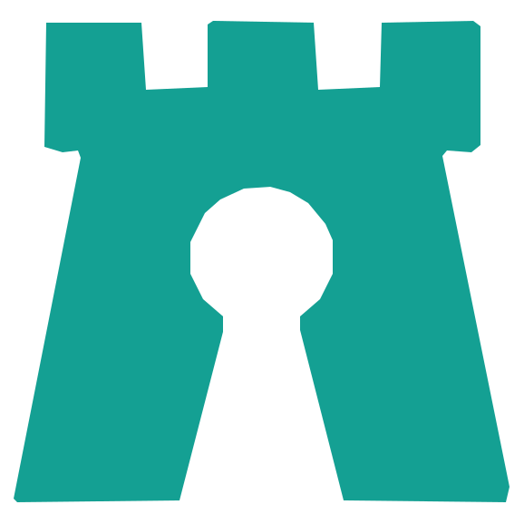
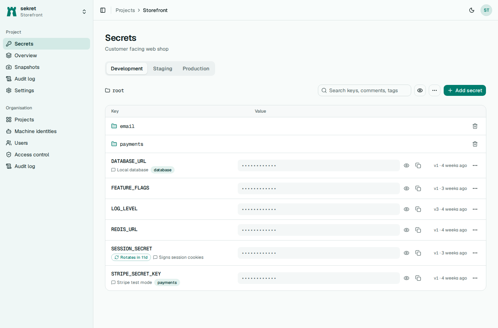
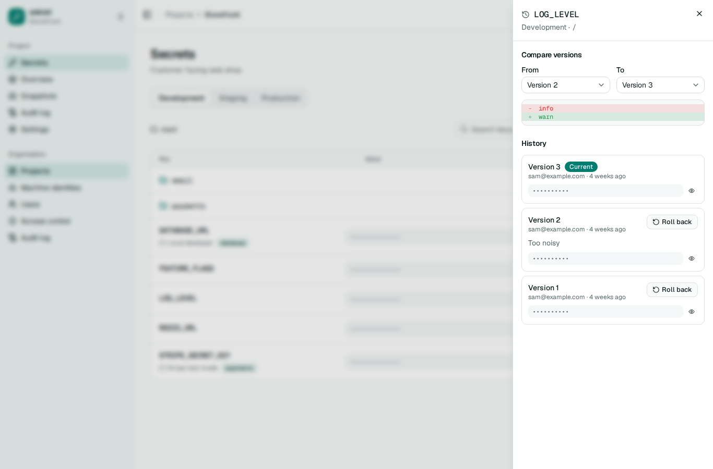
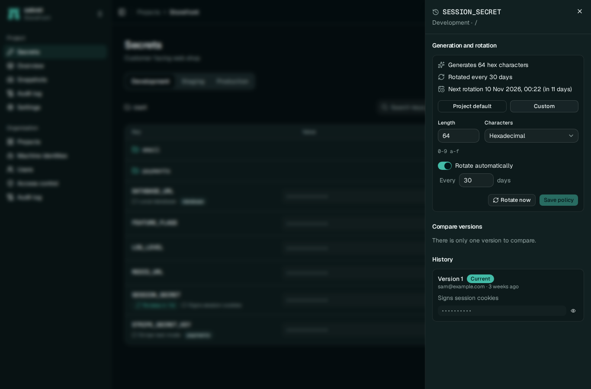
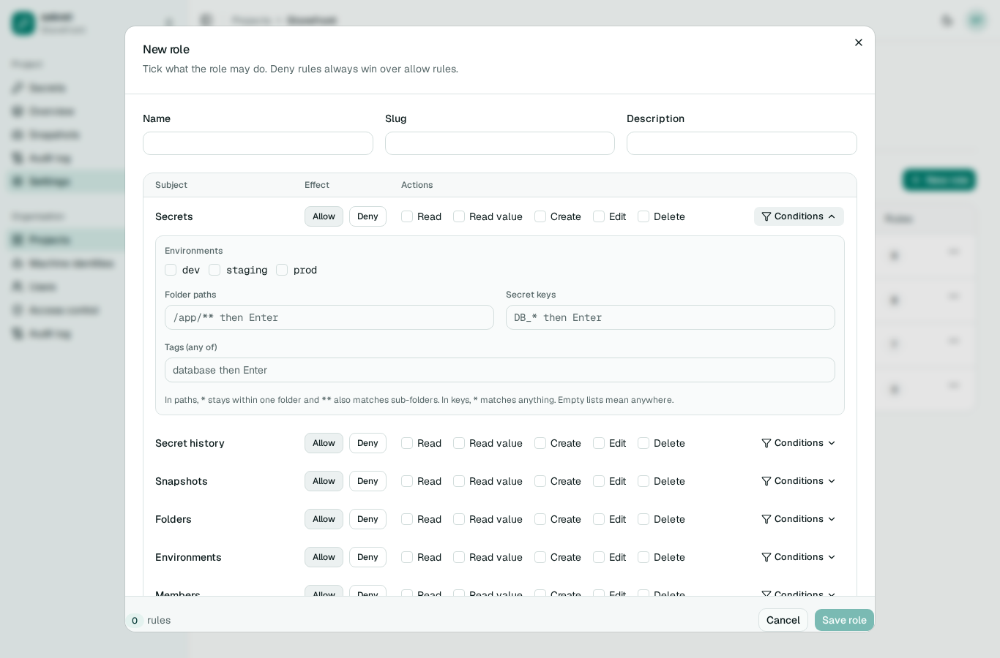
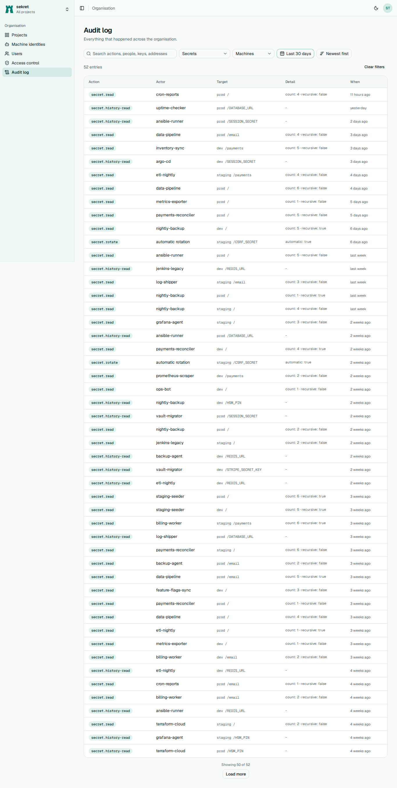

<p align="center"></p>

# sekret

sekret is a self-hosted secrets manager that ships as one static Linux binary. That one file runs the server with its web interface, the command-line client and a Kubernetes operator. It keeps secrets per project, environment and folder, keeps every version, and encrypts each value with XChaCha20-Poly1305 under a root key you hold.

People sign in through your OpenID Connect provider. CI jobs, Kubernetes pods and Ansible runs log in as machine identities with tokens they already have, so there are no shared passwords to hand out. Encryption happens on the server, so whoever runs it can read the secrets; if that rules it out for you, it is better to know now.

```sh
curl -fsSL https://raw.githubusercontent.com/sam-ruff/sekret/main/install.sh | sh
```

The script installs the latest release for x86-64 Linux after checking its SHA-256. The container image is `ghcr.io/sam-ruff/sekret`.



## What it does

- Secrets in projects, environments and folders, with tags, comments and `.env` import
- Full history with diffs, single-secret rollback and whole-environment snapshot restore
- Sign-in through any OIDC provider, with its groups mapped to sekret roles
- Machine identities for GitHub Actions and other OIDC issuers, Kubernetes service accounts, or a client id and secret
- Roles with conditions on environment, folder, key and tag, where a deny always wins
- Generated values with optional scheduled rotation
- A searchable audit log of every value read and every change
- `sekret run`, `sekret export` and `sekret-env` for getting secrets into processes and shells
- An Ansible collection, a Kubernetes operator with a Helm chart, and mutual TLS for every client

<table>
  <tr>
    <td></td>
    <td></td>
  </tr>
  <tr>
    <td></td>
    <td></td>
  </tr>
</table>

## Try it

```sh
sekret admin generate-root-key > root.key
sekret server --public-url http://localhost:8080 --root-key-file root.key &
export SEKRET_URL=http://localhost:8080
export SEKRET_TOKEN=$(sekret admin bootstrap --root-key-file root.key)

sekret projects create demo
sekret secrets set -p demo -e dev DATABASE_URL=postgres://localhost/demo
sekret secrets generate -p demo -e dev SESSION_KEY
sekret run -p demo -e dev -- env | grep -c SESSION_KEY
```

The [documentation](https://sam-ruff.github.io/sekret/) covers configuration, deployment with systemd or containers, access control, machine identities, the integrations and every CLI command.

## Building from source

You need Rust 1.98 and Node 24. `npm run build` in `web/` builds the interface that the binary embeds, and `scripts/build-release.sh` produces the static release binary. `cargo test --workspace` runs the unit and integration tests against SQLite, and against Postgres too when Docker is available. `scripts/system-test.sh` adds Keycloak, k3s, Ansible and browser tests.

sekret is MIT licensed.
