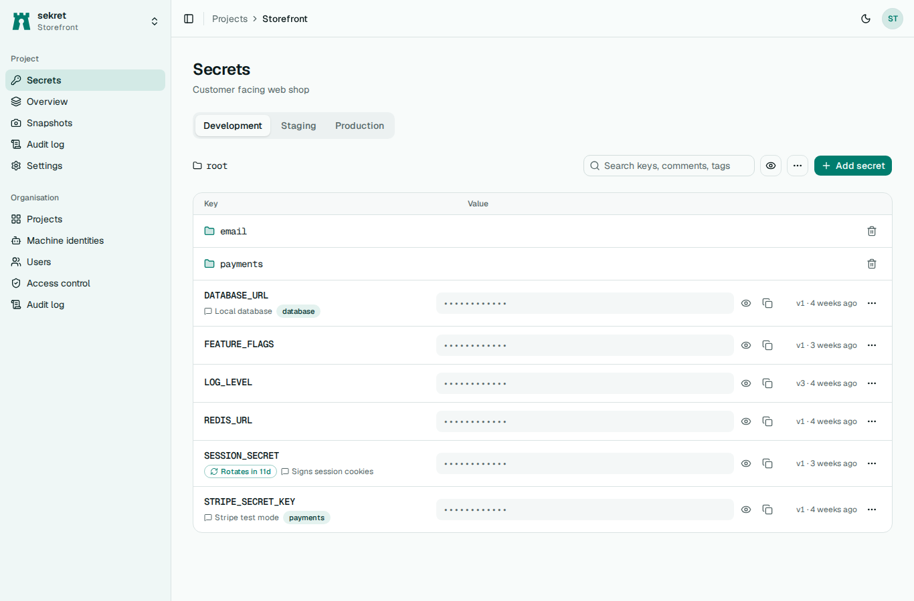

# sekret

sekret is a self-hosted secrets manager that ships as one static Linux binary of about 25 MB. The same file runs the server and its web interface, the command-line client and a Kubernetes operator. It keeps secrets per project, environment and folder, keeps every version, and encrypts each value with XChaCha20-Poly1305 under a key that never leaves the server's root key file.

People sign in through an OpenID Connect provider such as Keycloak. Machines (CI jobs, Kubernetes pods, Ansible runs) log in as machine identities using tokens they already hold, so there are no long-lived passwords to hand out. The design follows the parts of Infisical that a small team or a single server needs, but encryption is server-side only: anyone who holds the root key and the database can read everything, which is the trade-off for having no client-side key management.

## What it does

- Secrets grouped by project, environment (`dev`, `staging`, `prod` or your own) and folder, with tags and comments.
- Full history for every secret, a line diff between versions, single-secret rollback, and snapshot restore of a whole folder or environment.
- Sign-in through any OIDC provider, with provider groups or roles mapped to sekret roles.
- Machine identities that log in with GitHub Actions OIDC tokens, Kubernetes service account tokens, or a client id and secret.
- Role-based access with conditions on environment, folder, key and tag. Deny rules win, and nobody can grant more access than they hold.
- Generated values with optional scheduled rotation, set per project or per secret.
- An audit log of every value read and every change, with search and filters.
- A CLI that can run commands with secrets, export them, or load them into the current shell.
- An Ansible collection and a Kubernetes operator that syncs secrets into native `Secret` objects.

## Where next

[Getting started](getting-started.md) has the server running and a secret stored in about five minutes. [Deployment](deployment.md) covers running it for real: systemd, the container image, Postgres, backups and the root key. The [user guide](user-guide/projects.md) explains projects, access control and machine identities, and the [CLI reference](cli.md) lists every command.
