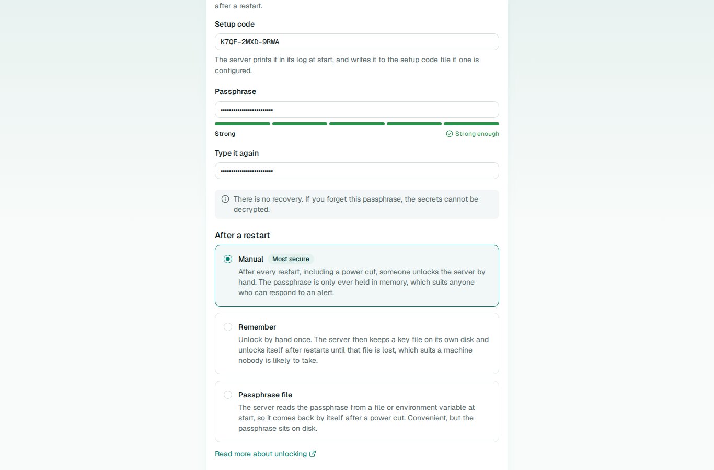
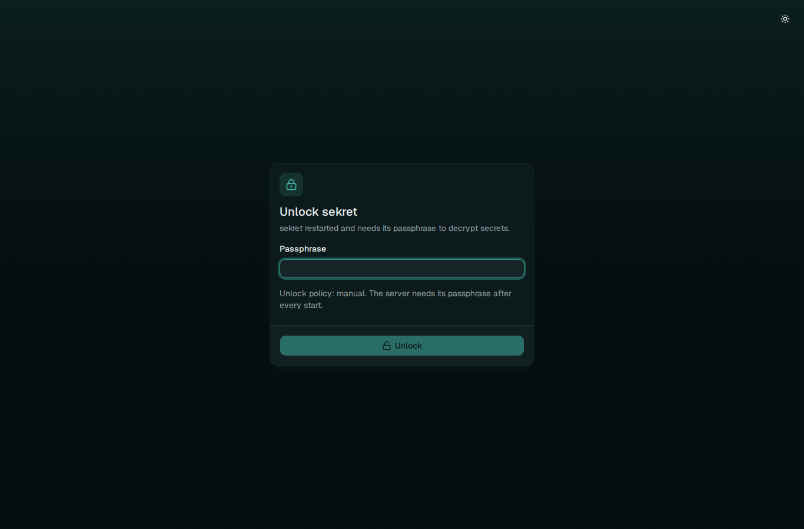

# Unlocking

In passphrase mode the root key is stored wrapped under your passphrase, and the server has to get it back into memory every time it starts. Until it does, the server is sealed: it answers `GET /api/v1/sys/status` and health checks, and refuses everything else with 503. The unlock policy decides how a sealed server gets unlocked.

There are three policies. Choose one at setup, change it later on the Server page under Organisation or with `sekret sys unlock-policy`, or fix it in configuration with `seal.unlock`, in which case configuration wins and the interface shows it as set there. Key-file mode has no policy, because the key file is read on every start.



## Manual

Someone unlocks the server by hand after every start, on the unlock page or with `sekret sys unseal`. The passphrase is typed, used and wiped; the unwrapped root key exists only in the server's memory and nowhere else. Anyone who opens the web interface while the server is sealed lands on the unlock page, and goes back to where they were heading once it is unlocked.



This is the default and the strongest choice. Someone who walks off with the disk, the database, a backup or the whole powered-down machine gets nothing they can read without the passphrase. The cost is availability: after a power cut, a kernel update or a crash, every application that reads secrets from sekret waits until a person unlocks it. Pair it with an alert on the status endpoint (see [Deployment](deployment.md#alerting-when-sealed)) so that person knows.

It suits a home lab or small team where someone is usually around, and anything where a stolen disk would be a real problem.

## Remember

Someone unlocks the server by hand once, and from then on it unlocks itself on every start, until the remember file is lost or deliberately forgotten.

On the first manual unlock under this policy, the server generates a random 32-byte device key and writes it to the remember file with mode 0600. It refuses to write through a symlink or over an existing file it did not just remove. It then stores a second copy of the root key in the database, wrapped under that device key. On each start it reads the file, unwraps that copy and is unlocked. Neither half is any use alone: the database copy needs the file, and the file is only a random key.

There is no default location for the remember file. Set `seal.remember_file` (or `--remember-file`, `SEKRET_REMEMBER_FILE`) before choosing this policy; setup and the API refuse `remember` without it. It may not be the database, the root key file or a passphrase file, and the server warns at start when it sits in the database's directory, because then one copy of that directory unlocks the server. Keep it on a different disk from the database if you can, and keep it out of backups; `.skb` backups never include the database copy.

The file is opened without following symlinks and without blocking, and anything that is not a regular file is refused. When the server replaces or forgets it, it only deletes a regular file the size of a device key (or a symlink, never its target), so a mistyped path cannot delete something else.

After a power cut the server comes back unlocked, as long as the file and the database are both still there. If the file is missing, or does not match because it is from another server or was changed, the server stays sealed and logs why. The next manual unlock writes a fresh file.

The trade-off is the threat model. Someone with the server's disk, both the file and the database, can unlock it, just as with a key file. Someone with only a database dump or only a backup cannot. So this policy protects against leaked backups and database dumps, not against a stolen machine, unless you add a remember secret.

### Remember secret

A remember secret closes the stolen-disk gap. Set `seal.remember_secret_file` (or `--remember-secret-file`, `SEKRET_REMEMBER_SECRET_FILE`) to a file holding at least 32 random characters, or pass the value itself in `SEKRET_REMEMBER_SECRET`. The server then wraps the remembered root key under a key derived from the device key and the secret together (HKDF-SHA256), so the database and the remember file alone cannot unlock it. Deliver the secret from somewhere that is not the data disk, such as a systemd credential or a secret mounted from elsewhere.

One trailing line ending is dropped, the same as for passphrases, and the environment variable is removed from the process as soon as it is read. If the secret is missing or wrong, the server stays sealed and says so in its log. Unlocking by hand then writes a fresh remember file under the secret now configured.

### Sealing by hand

"Seal now" and `sekret sys seal` drop the root key from memory but keep the remembered unlock, so the next restart unlocks itself again. The status endpoint keeps reporting `remembered: true` while that is so. To make the next start need the passphrase, forget the unlock as well.

To stop remembering, choose another policy or run `sekret sys forget-unlock` (or "Forget remembered unlock" on the Server page). Both delete the file and the database copy, and the next start needs the passphrase.

## Passphrase file

The server unlocks itself at start with a passphrase read from `seal.passphrase_file` or the `SEKRET_UNLOCK_PASSPHRASE` environment variable. It reads either one only when this policy is in force (or automatic setup is running), once, at start, and drops one trailing line ending.

Prefer the file. The server removes `SEKRET_UNLOCK_PASSPHRASE` from its environment as soon as it starts, so nothing it runs inherits it, but Linux keeps the original bytes in `/proc/<pid>/environ` for the life of the process, readable by the same user and by root. The server also logs a warning when this policy itself comes from the environment rather than the configuration file.

This keeps the passphrase on disk or in the process environment, which is about as strong as key-file mode: anyone who can read that file or the service's environment can unlock the server. It exists for setups that already deliver secrets from somewhere else, such as a vault agent or a systemd credential, and want one way of doing things. If the passphrase is wrong or missing, the server stays sealed and logs why.

## What an attacker gets

| Has | Manual | Remember | Passphrase file | Key-file mode |
|---|---|---|---|---|
| A `.skb` backup | Nothing without the passphrase | Nothing without the passphrase | Nothing without the passphrase | Nothing without the key file |
| A database dump | Metadata only | Metadata only | Metadata only | Metadata only |
| The server's disk | Metadata only | Every secret, unless a remember secret is set and kept elsewhere | Every secret if the passphrase file is on it | Every secret if the key file is on it |
| A running server as root | Every secret | Every secret | Every secret | Every secret |

"Metadata" means key names, folder paths, comments, tags, users, identities and the audit log, which are stored in plain text; see [Security model](security.md#what-the-database-and-backups-contain). No policy protects a running server from whoever controls it.

## After a power cut

- **Manual**: the server comes up sealed. The status endpoint reports `sealed`, monitoring alerts, someone unlocks it, and applications retry until they succeed.
- **Remember**: the server unlocks itself. If the remember file did not survive, it behaves like manual until someone unlocks it once.
- **Passphrase file**: the server unlocks itself as long as the passphrase source is still there.

Clients see 503 with the error `sealed` while the server is sealed. The Kubernetes operator keeps the Secrets it already wrote and tries again on its next pass; scripts and CI jobs should retry. Nothing needs restarting once the server is unlocked.

## Changing the policy

```sh
sekret sys unlock-policy remember          # asks for the current passphrase
sekret sys unlock-policy manual
```

`remember` and `passphrase-file` make the server easier to unlock without a person, so they need the current passphrase as well as an organisation admin (`passphrase` in the body of `PUT /api/v1/sys/unlock-policy`, or `--passphrase-file` on the CLI). Going back to `manual` makes things stricter and needs no passphrase. Moving to `remember` while unlocked writes the remember file straight away. Moving away from it forgets the remembered unlock. When `seal.unlock` is set in configuration, change it there and restart; the API refuses to change it.

## The policy cannot be changed behind your back

The stored policy, mode, root key fingerprint, the passphrase wrap and the remembered wrap are signed together with an HMAC under a key derived from the root key, along with a counter that goes up with every change. The server checks the signature each time it recovers the root key. Someone who can write to the database but does not hold the root key cannot switch `manual` to `remember` and wait for your next unlock: the signature fails, the server falls back to `manual`, writes no remember file, logs an error and records `sys.seal_config.tampered` in the audit log. A server that would have unlocked itself stays sealed instead.

Databases from before signing are signed on their first unlock. If such a database asks for `remember` with nothing remembered yet, which nothing can vouch for, it is treated as `manual` until an admin chooses the policy again.

What the signature cannot catch is a full rollback of the seal configuration to an earlier state that was genuinely signed, for example by restoring an old database file. Changing the passphrase replaces the root key, so an older configuration no longer matches the data.

## Forgetting the passphrase

There is no recovery key, and nobody, including the people who wrote sekret, can reset a passphrase. If it is lost, the data is gone, and so is every backup taken under it. A server that is unlocked at the time keeps working until it is sealed or restarted, and a remember file keeps letting it start, so export anything you need while you still can and set up a new server. Store the passphrase somewhere that does not depend on sekret.
