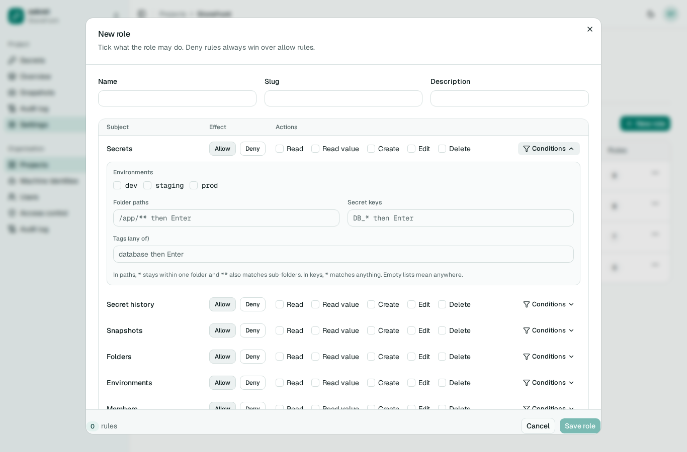

# Access control

Access is granted by roles. A role is a list of rules, each of which allows or denies some actions on one kind of thing, optionally only where certain conditions hold. People, groups from your OIDC provider, and machine identities all receive roles the same way.

There are two scopes. Organisation roles cover projects in general, machine identities, users and the organisation audit log. Project roles cover everything inside one project.

## Built-in roles

| Role | Scope | What it allows |
|---|---|---|
| `org-admin` | organisation | Everything, in the organisation and in every project. |
| `org-member` | organisation | Create projects, and read identities, users and organisation roles. Everyone who signs in gets this unless `--default-org-role` says otherwise. |
| `admin` | project | Everything in the project. |
| `developer` | project | Read, write and delete secrets, read history, restore snapshots and manage folders. |
| `viewer` | project | Read secrets and their values, and read the rest of the project's metadata. |
| `no-access` | project | Nothing. Useful for an explicit membership. |

Whoever creates a project becomes its `admin`. People in one of the `--oidc-admin-groups` groups are `org-admin` from their first sign-in.

## Rules

A rule has an effect (`allow` or `deny`), a subject, a list of actions and optional conditions.

The actions are `read`, `read-value`, `create`, `edit` and `delete`. `read` on secrets shows key names and metadata; `read-value` is needed to see values.

Project subjects are `secrets`, `secret-versions`, `snapshots`, `folders`, `environments`, `members`, `roles`, `audit-log` and `settings`. Organisation subjects are `projects`, `identities`, `org-members`, `org-roles` and `org-audit-log`.

Conditions narrow a rule to some secrets:

| Condition | Matches |
|---|---|
| `environments` | Environment slugs, such as `["dev", "staging"]`. |
| `paths` | Folder globs. `*` matches within one folder, `**` across folders: `/payments/**`. |
| `keys` | Key globs, such as `DB_*`. |
| `tags` | Secrets carrying any of these tags. |

All conditions in one rule must hold for it to apply. Lists of patterns are limited to 50 entries of 256 characters.

This custom role lets a team read and change everything in `dev` and `staging`, read key names in `prod` but not values, and never read anything tagged `restricted`:

```json
{
  "name": "Payments team",
  "rules": [
    {"effect": "allow", "subject": "secrets", "actions": ["read", "read-value", "create", "edit", "delete"],
     "conditions": {"environments": ["dev", "staging"]}},
    {"effect": "allow", "subject": "secrets", "actions": ["read"], "conditions": {"environments": ["prod"]}},
    {"effect": "deny", "subject": "secrets", "actions": ["read-value"], "conditions": {"tags": ["restricted"]}},
    {"effect": "allow", "subject": "environments", "actions": ["read"]}
  ]
}
```

The web interface has an editor for this, with a grid of subjects and actions and a conditions builder for each rule.



## How a decision is made

For a given action on a given secret, sekret collects every rule from every role the person holds, through their own membership, their groups and their organisation roles. If any matching rule denies, the answer is no. Otherwise, if any matching rule allows, the answer is yes. Otherwise it is no.

A deny whose condition cannot be checked, for example a tag condition when the tags are not known yet, counts as matching. An allow in the same position does not. Both mistakes fail closed.

## Nobody can hand out more than they hold

Granting a role, editing one or adding someone to a project is only allowed when everything the role allows is something you already hold, without a deny on it. Removing a restriction counts the same way, so someone held back by a deny cannot remove that deny from themselves, delete the role it comes from, or edit it away. The same applies to machine identities: you can only mint credentials for, edit or delete an identity whose access you already cover.
