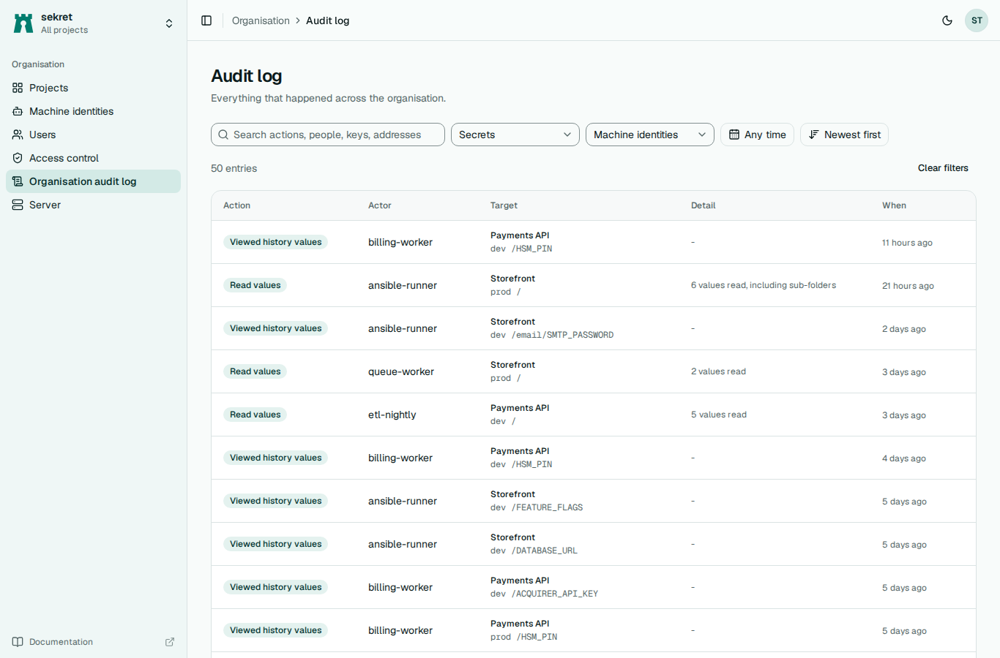

# Audit log

sekret records every change and every read of a value: who, when, from which address, which project, environment, folder and key, and what happened. Values are never written to the log, only key names and counts.

Each project has its own log under *Project audit log* in the project, readable with the project `audit-log` permission. The organisation log under *Organisation > Organisation audit log* covers everything, including sign-ins, identity changes and role changes, and needs the `org-audit-log` permission.

The project log only shows what the reader could see in the secrets view. If a role lets someone read the log but not a particular key, entries about that key appear with the key name, folder and details hidden. Entries for an environment the reader cannot list lose the environment as well.

People are shown by their email when the identity provider says it verified it, and otherwise by their display name. A display name that looks like an email address is shown with "(unverified)" after it, so nobody can pass for someone else's address in the log, in a secret's history or in member lists. The `actor_id` the API returns with each entry is what tells two people apart for certain.

In the web interface each entry says what happened in plain words, such as "Viewed history values" or "2 values read"; hovering over it shows the action's code, such as `secret.history-read`. The codes are what the action filter, the API and the CLI use. Entries store people, machine identities, roles and projects by ID; the web interface shows their names where it can look them up with what you may already see, and the ID otherwise. In the organisation log, each entry about a project names that project above its environment and key, and the name links to the project's own log, which is the place to narrow things down to one project. Opening the organisation log without permission to read it says which roles can, rather than showing filters that cannot work.



## Searching and filtering

The log page has a search box and filters for action, actor type, environment and a date range, and can be sorted oldest or newest first. The same filters work over the API:

```sh
curl -fsS -H "Authorization: Bearer $SEKRET_TOKEN" \
  "$SEKRET_URL/api/v1/projects/web/audit?action=secret.&environment=prod&since=1767225600&order=desc&limit=100"
```

| Parameter | Meaning |
|---|---|
| `q` | Text matched anywhere in the action, actor, environment, folder, key or address, ignoring case. |
| `action` | Action prefix: `secret.` for every secret action, `secret.read` for reads. |
| `actor_id`, `actor_kind` | One actor, or `user` or `identity`. |
| `environment`, `key` | Exact matches. |
| `path` | Folder prefix. |
| `since`, `until` | Unix seconds, both inclusive. |
| `order` | `desc` (newest first, the default) or `asc`. |
| `limit` | Page size, 1 to 500, default 50. |
| `cursor` | The `next_cursor` from the previous page. |

Each response holds `entries`, the `total` matching the filters, and a `next_cursor` when there is another page. Paging by cursor never skips or repeats entries that share a timestamp.

A match or a count can give away a hidden name even when the entries themselves are redacted, so readers with some secrets hidden from them are limited in the project log. For them, `q` only searches the action, actor and address, and `key` and `path` are refused with `filter_hidden` unless `environment` names an environment whose secrets they can all read. Filtering on an environment they cannot list is refused. The web interface says so in place of the results, with a button to drop the key and folder filters, and its search box leaves keys out of its hint. A search in that position also says that key names and folders were not searched, and suggests picking an environment whose secrets you can all read. The organisation log is not limited this way.

## Actions

The actions you will see most are `secret.read`, `secret.write`, `secret.rollback`, `secret.generate`, `secret.rotate`, `snapshot.restore`, `auth.login`, `auth.machine-login`, `auth.cli-login`, `auth.token-renew`, `identity.update`, `member.add` and `role.put`. Every action name has the form `area.verb`. Refusals worth watching are recorded too: `auth.machine-login.failed` (with the reason the caller is not told), `auth.login.refused`, `sys.unseal.failed`, `sys.unseal.refused`, `sys.forbidden`, `sys.seal_config.tampered` and `sys.seal_config.rolled_back`. Admin commands run on the server host appear as `admin.*` from the address `local`.

When a request came through a reverse proxy, the address is the client's and the detail also has `peer`, the address the connection itself came from. A machine login refused for an identity id that is not shaped like one, such as a client secret pasted into the wrong field, records the id only as `hash:` and a short hash. `auth.machine-login.failed` and `sys.forbidden` from the same caller and address are written once a minute at most: the first straight away, and any more in that minute as one later entry with `repeats` and `window_seconds` in its detail. Logins for identity ids that do not exist count as one caller per address, however many ids are tried, and in a flood from very many addresses at once, further refusals share one entry per action each minute. Approving or refusing a `sekret login` (`auth.cli-approve`, `auth.cli-deny`) records the address and program the request came from and when it was made.

A browser sign-in or `sekret login` approval turned away by `oidc.allowed_subjects` or `oidc.required_groups` is recorded as `auth.login.refused`, with the subject and the reason in its detail.
