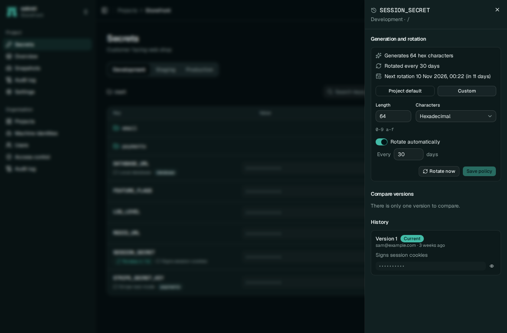

# Generation and rotation

sekret can fill a secret with a random value and replace it on a schedule. Both are off until you turn them on, and automatic rotation only ever replaces values that sekret generated. A value someone pasted in, such as an API key from a vendor, is never overwritten, even if the project's default says to rotate every week.

Generation is useful for anything both ends read from sekret: session keys, webhook signing secrets, a password one service sets and another uses. Rotation suits values whose consumers pick up the new one by themselves, for example through the [Kubernetes operator](../integrations/kubernetes.md), which refreshes every few minutes. sekret does not log in to a database or vendor to change a password there, so rotating such a password in sekret alone would break things.



## Generating a value

```sh
sekret secrets generate SESSION_KEY
sekret secrets generate PIN --length 6 --charset numeric
```

Generation creates the secret if it does not exist, and never prints the value. In the web interface, the new-secret and edit dialogs have a *Generate* button.

| Character set | Characters | Bits per character |
|---|---|---|
| `alphanumeric` (default) | A-Z, a-z, 0-9 | 5.95 |
| `symbols` | alphanumeric plus `!#%+,-.:=@^_~` | 6.2 |
| `hex` | 0-9, a-f | 4 |
| `base64url` | A-Z, a-z, 0-9, `-`, `_` | 6 |
| `numeric` | 0-9 | 3.3 |

The default length is 32, which with `alphanumeric` is about 190 bits. Lengths run from 8 to 512. Values come from the operating system's random source, and bytes that would make some characters more likely than others are discarded.

## Policies

A policy says how to generate a value and, optionally, how many days a generated value lasts. The project default applies to every secret that does not set its own:

```sh
sekret policy --rotate-days 30 --length 48 --charset symbols
sekret policy --off
```

A secret can follow the project, or set its own policy, including one that turns rotation off:

```sh
sekret secrets policy SESSION_KEY --rotate-days 7
sekret secrets policy VENDOR_API_KEY --off
sekret secrets policy SESSION_KEY --inherit
sekret secrets policy SESSION_KEY
```

The last command shows the policy in force, where it comes from and the next rotation time.

Changing the project default needs the right to edit settings and unrestricted rights to create and edit secrets, because it changes every inheriting secret. Changing one secret's policy needs the right to edit that secret.

## How rotation runs

The server checks every five minutes for generated values older than their policy allows and replaces them. Each rotation is an ordinary new version, written by `identity:automatic rotation`, recorded in the audit log as `secret.rotate` and captured in a snapshot. Rolling back to an older value works as usual, and the rolled-back value keeps its generated status.

Rotation happens on schedule only while the server is running. A server stopped over the due time rotates on its first check after it starts.
