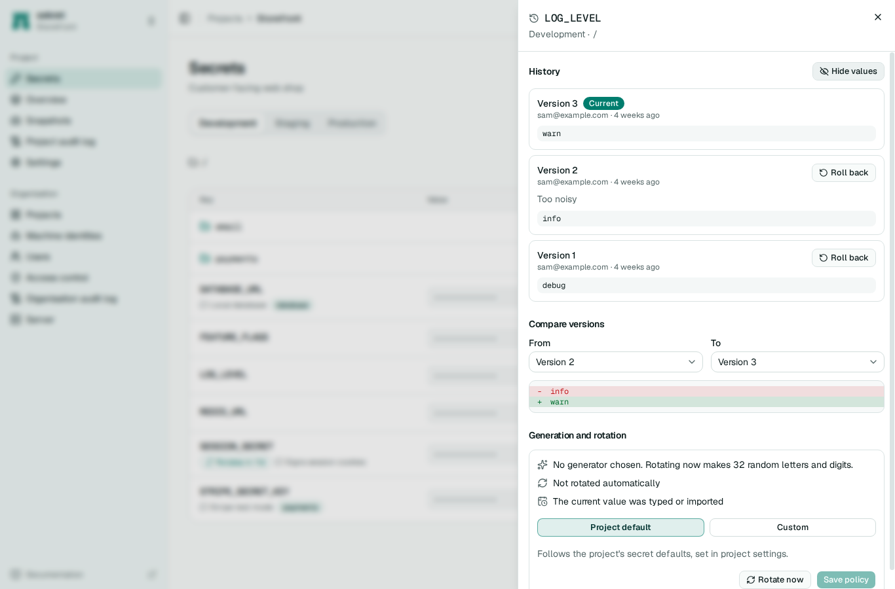

# Secrets, history and snapshots

A secret is a key, a value and some metadata: a comment and tags. Keys start with a letter or underscore and may contain letters, digits, `_`, `-` and `.`, up to 256 characters. Values can be up to 64 KiB of text, and comments up to 1,024 characters.

Every change writes a new version. Nothing is ever edited in place, so the history of a secret is complete, and rolling back is itself a new version that copies an old value.

## Setting and reading

```sh
sekret secrets set DATABASE_URL=postgres://db/app API_KEY=-   # `-` reads the value from standard input
sekret secrets set --from-dotenv .env.example
sekret secrets list --values
sekret secrets get DATABASE_URL
sekret secrets delete OLD_KEY
```

In the web interface, values are masked until you reveal them, and every reveal is recorded in the audit log. Switching to another environment or folder masks everything again, and so do three minutes without touching the page, an ended session or a locked server. The three minutes are measured by the clock, so values left on screen when a laptop went to sleep are masked as soon as the page is seen again. The same applies to anything holding a typed or pasted value: the edit form, the new secret form and the import dialog close after three idle minutes and drop anything not yet saved. Hiding values forgets them in the browser too, so revealing them again asks the server and is recorded again.

A folder with many secrets shows the first 100, with a button to show more. *Reveal all* is turned off in a folder with more than 100 secrets, so one click cannot pull every value at once; reveal them one at a time instead.

On the project overview, which lists every key across every environment, a *Missing* cell opens that environment with the new secret form already holding the key. A copied value is cleared from the clipboard after 45 seconds if it is still there. Browsers only allow that while the tab has focus, so if you have moved to another window by then, sekret clears it when you come back, or tells you to clear it yourself when it cannot check what the clipboard holds. Signing out or being sent to sign in again clears it straight away. Closing or reloading the tab first asks you to confirm and tries to clear it, but the browser may refuse, for example when the tab is closed from another window, so clear the clipboard yourself if you are not sure. Pasting a `.env` file into the import dialog creates or updates every key in it in one write; closing the dialog throws the pasted text away.

Reading a key name and reading its value are separate permissions, so a role can let someone see which keys exist without seeing any values.

## History and rollback

```sh
sekret secrets history DATABASE_URL --values
sekret secrets history DATABASE_URL --diff 3 5
sekret secrets rollback DATABASE_URL 3
```

The web interface shows the same history in a drawer, with a button to roll back. Values stay hidden until you choose "Show values", which is recorded in the audit log; then it shows each version's value and, once there are two versions, a line diff between any two of them. Versions that differ in a great many lines are not compared. A long history opens on its newest 50 versions, with "Load older versions" below them for the next 50; showing values and the diff cover only the versions loaded so far. The secret's generation and rotation settings sit below the history. Closing the drawer or opening another secret hides them again.

The API hands history out newest first, 100 versions at a time unless `limit` asks for fewer or more (up to 200). A page shorter than `limit` is the last one; for the next, pass the oldest version you have as `before`, as in `.../secrets/DATABASE_URL/versions?limit=50&before=151`. With `values=true`, only the versions on that page are decrypted.

A rollback keeps the restored version's comment, noting the rollback in front of it, as in `rolled back to version 2: Too noisy`. Rotating a secret by hand from the web interface keeps its current comment; the audit log records the rotation.

The edit form opens only once the current value has loaded. If it cannot be loaded, the form says so and offers to try again, so saving a comment or tag change can never replace the value with an empty one. When your roles hide a value, editing the secret means typing a replacement for it.



## Snapshots

Every write to an environment, whether one secret or a hundred, records a snapshot of that environment's state afterwards. Restoring a snapshot puts the environment, or one folder of it, back the way it was: changed secrets go back to their old values, added ones are deleted and deleted ones come back. The restore is one new write, so it can be undone by restoring the snapshot before it. Removed secrets keep their history.

In the web interface, opening a snapshot lists what restoring it would change, and the confirmation names the secrets it would remove. A restore that removes anything is shown in red.

```sh
sekret snapshots list
sekret snapshots restore 0192d4a8-... --path /payments
```

The server keeps the newest 200 snapshots per environment by default (`--snapshots-to-keep`). Pruning a snapshot does not delete any secret versions.

## Tags

Tags are short labels such as `pii` or `rotating`. They show in the interface and, more usefully, they can be matched by access rules: a deny on reading values tagged `restricted` applies to every secret carrying the tag, wherever it lives.
